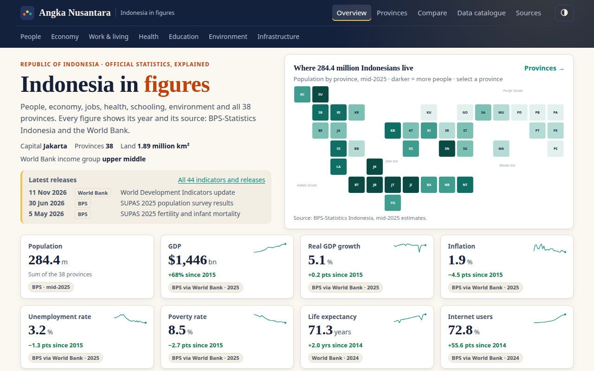

# Angka Nusantara: Indonesia in figures

[](https://make.fun/bounty/best-national-statistics-site-20261126-0539)
[](https://make.fun/bounty/best-national-statistics-site-20261126-0539)
[](https://make.fun/bounty/best-national-statistics-site-20261126-0539)

An independent national statistics site for Indonesia, entered in the make.fun bounty
"Make the best national statistics site". Every figure shows its year and its source.



## What's in it

| Page | Address | What a visitor gets |
|---|---|---|
| Overview | `#/` | Eight headline figures with trends, a population map of the 38 provinces, the long view, doors into every topic |
| Topics | `#/topic/<people, economy, work, health, education, environment, infrastructure>` | Headline tiles, charted stories with plain-language text, a table of every indicator in the topic |
| Indicator | `#/indicator/<id>` | Latest value and 10-year change, chart with a time-range control and hover tooltip, every yearly value, definition, source and series code, CSV download |
| Provinces | `#/regions` | Tile map shaded by population, density or land area; totals by island group; a table that sorts, searches and filters; CSV download |
| Province | `#/region/<iso>` | Population, share, land and density with ranks among the 38, its island group compared |
| Compare | `#/compare/<id>` | Indonesia beside India, Malaysia, the Philippines, Thailand and Viet Nam on twelve measures |
| Data catalogue | `#/data` | All 44 indicators, searchable and filterable by topic |
| Sources | `#/about` | Agencies, how figures were checked, caveats for reading them |

## Data

- **44 national time series (1990–2025)** from the World Bank World Development Indicators, update of
  11 November 2026, compiled from BPS-Statistics Indonesia, the UN Population Division, ILO, IMF, UNESCO, WHO/UNICEF,
  FAO, EDGAR and ITU. Each series was checked value by value against the WDI API.
- **38 provinces**: BPS mid-2025 population estimates and land area. They sum to 284,438,600 people, BPS's national
  mid-2025 total.
- **Neighbour comparison**: the latest WDI value for each of six countries.
- **One headline population**: the cover and province pages use BPS's 284.4 million (the province sum); the population
  series and the comparison use the World Bank/UN 285.7 million. The population and density pages explain why the two
  differ, and every headline card carries a source tag (BPS / World Bank) with its year.
- **Latest releases**: a dated list of the publications behind the figures, on the overview and the data catalogue.
- Every indicator page has a definition, a method note, its source and series code, and a CSV download.

All data lives in `app/data/`; the site makes no network requests.

## Structure

Plain HTML, CSS and ES modules with hand-drawn SVG charts, no framework and no build step. The first load is four
files (`index.html`, `styles.css`, `main.js`, `router.js`, about 8 KB gzipped); each page and its data load on
first visit through `import()`.

```
app/
  index.html  styles.css  main.js (masthead, theme)  router.js (hash routes, lazy pages)
  lib/      format.js (numbers)  dom.js (escaping, CSV, resize)
  charts/   line-chart.js  bar-chart.js  tile-map.js  sparkline.js  tooltip.js  scale.js
  data/     indicators.js  topics.js  provinces.js  peers.js  sources.js (source tags, methods, two-number notes, releases)
  views/    home.js  topic.js  indicator.js  regions.js  province.js  compare.js  catalogue.js  about.js  parts.js  not-found.js
```

## Run it

```sh
node serve.ts                                        # http://localhost:8080
mkdir -p out && MAKEFUN_OUTPUT_DIR=out node main.ts  # build the hand-in (app/, screenshots/, dossier.json)
```

Screenshots in `screenshots/` are real renders of this code taken with Playwright; `shots.json` lists the view each
was taken of.

## License

MIT. The underlying data belong to the agencies named on each page; World Bank data are CC BY 4.0.
